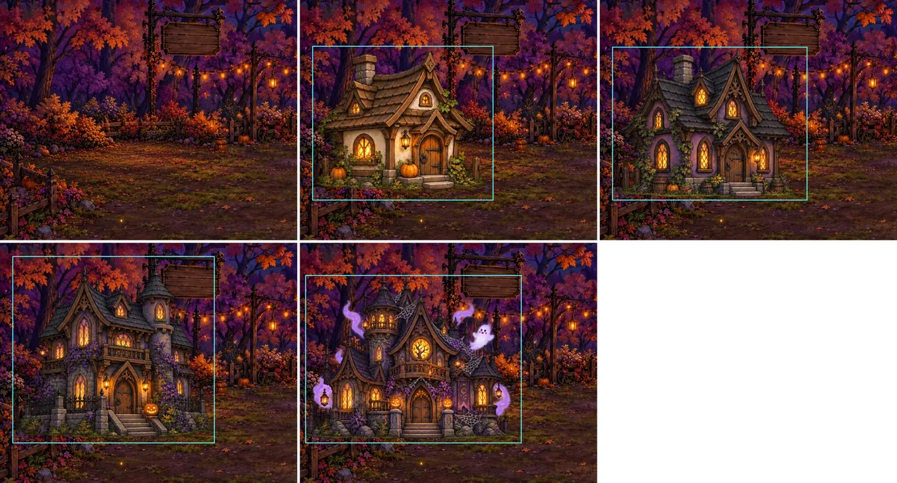
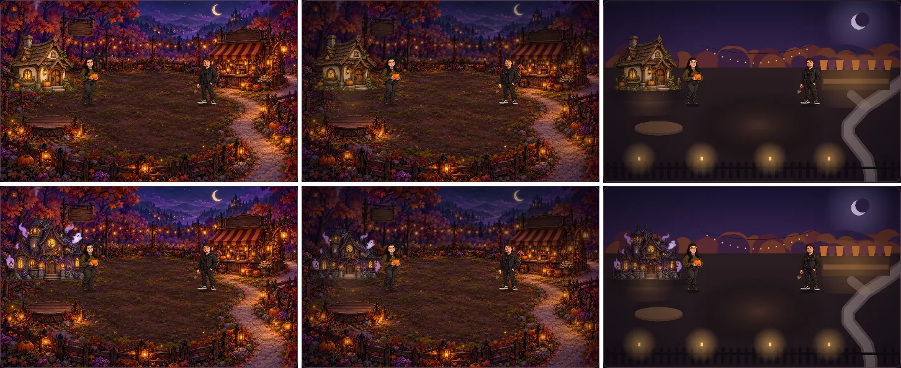

# Background and staging tests

I made these tests (17 October 2026) because the farm map felt busy and the house seemed to clip into the background. The test page is `prototypes/staging/index.html`. Open it through `npm run dev` or directly in Chrome, and switch between the four house stages.

## What's wrong with the current staging

*Top left is the map on its own. The other four frames are the house stages as the game draws them; the cyan box is each sprite's area.*

| Problem | Cause |
| --- | --- |
| **The house floats.** | The map paints an empty clearing, and the house is a separate picture pasted on top. There is no contact shadow and no worn ground under it, so nothing ties it to the earth. |
| **Upgraded houses clip the scenery.** | Stages 3 and 4 are taller and wider than the clearing. They draw over the hanging sign, its post and the string lights, all of which are painted into the map *behind* where the house should stand. |
| **Every stage is a different size.** | Widths run from 255 to 305 map units and tops from y = 59 to 106. Stage 4 starts at x = 8, so it hangs off the left edge. |
| **Lighting doesn't match.** | The house sprites are lit and saturated a little differently from the map, so they read as stickers. |
| **The map is busy.** | Every area has the same amount of detail: trees, flowers, lanterns, pumpkins and fences everywhere. Nothing tells the eye where to look, and small game sprites get lost against it. |

## Three versions of the same moment

*Columns, left to right: A original, B restaged original, C generated background. Rows: house stage 1, then stage 4.*

| Version | What it does | Result |
| --- | --- | --- |
| **A · Original** | The game today | Rich and atmospheric, but cluttered. The stage-4 house covers the sign. |
| **B · Restaged original** | Same art. The upper band is softened and darkened (depth of field), edges are vignetted, and every house stage fits one footprint on one base line, with a contact shadow, a slightly cooler grade and window light on the ground. The sign is redrawn in front of the house. | **Fixes the clipping and the floating.** The house sits in the clearing at every stage. Softening calms the background but turns painted detail to mud, so it is a stop-gap, not a look. |
| **C · Generated background** | A background drawn in code in the same layout: flat hills, soft tree canopies, lit clearings where things happen, the stone path following the visitor route, and a clean fence. | **Easy to read and calm.** Everything important stands out. But it is far too plain next to the painted sprites: the cottage and characters look pasted on. Code-drawn shapes can't hold up against this art style. |

## Recommendations

1. **Ship B's staging rules now.** They are small and safe:
   - one fixed footprint and base line for all house stages (centre x = 150, base y = 318, at most 250 × 230)
   - a contact shadow and window light on the ground
   - the sign layer drawn in front

   This needs only `refreshMapHouse` and the draw order changed. Skip the blur.
2. **For new map art, brief for layers, not a single picture.** Whoever paints or generates the next map should deliver:
   - **Sky and far background**: moon, hills, castle. Low contrast and cool.
   - **Treeline band**: detailed but darker, as one layer so it can be softened or swapped by season.
   - **Ground plate**: the clearing, the patch oval and the stone path, with **empty, worn ground where the house, the big pumpkin's stage and the shop stand**. Each has a fixed footprint marked in the brief.
   - **Props in front**: the sign and post, string lights, the fence and lanterns, as separate transparent layers. The game can then depth-sort them with characters and the house.
3. **Spend detail where the eye should go.** Version C shows the value: the patch, the counter and the doorway should be the brightest and most detailed areas, with everything else one step quieter. A new painted map should keep A's richness but follow C's structure.
4. **The voxel reference version** (the `voxel-reference` branch) builds the whole scene in layers from the start. It is a useful model for the layered brief.
