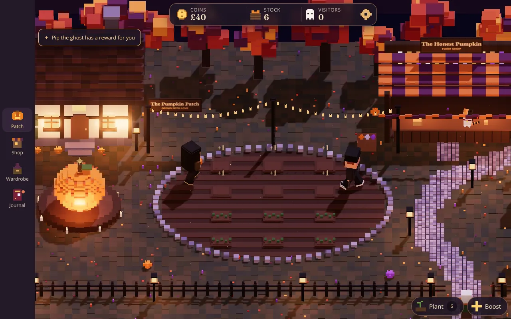
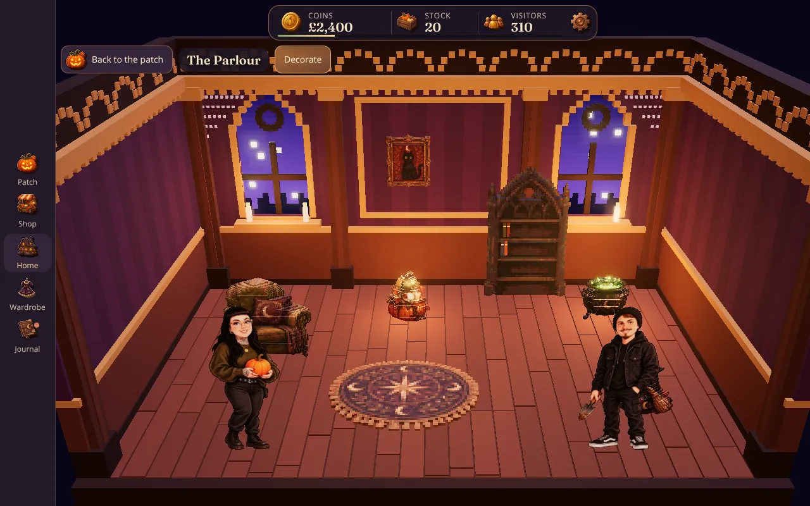
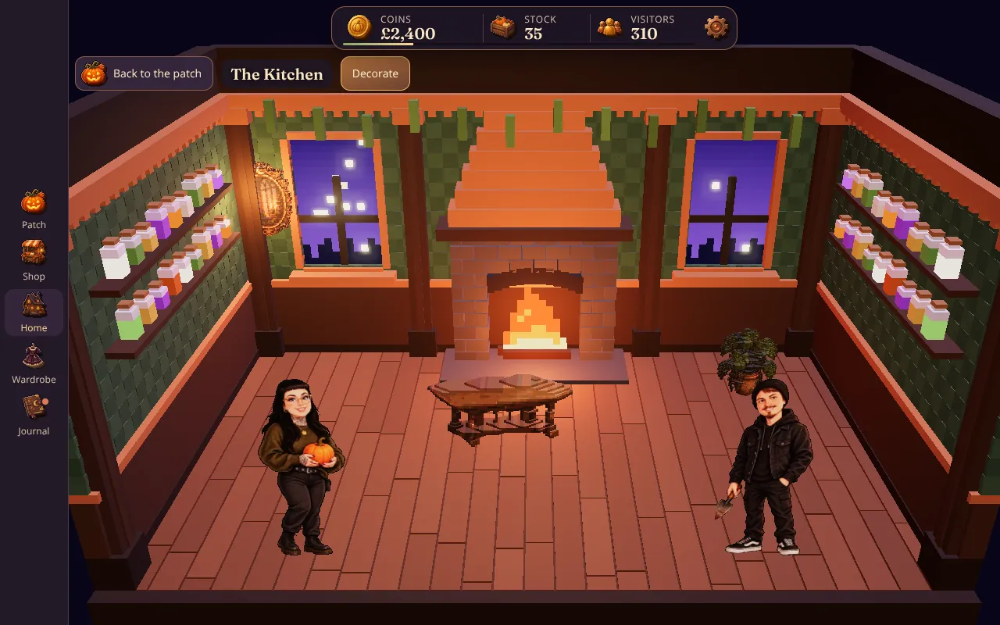
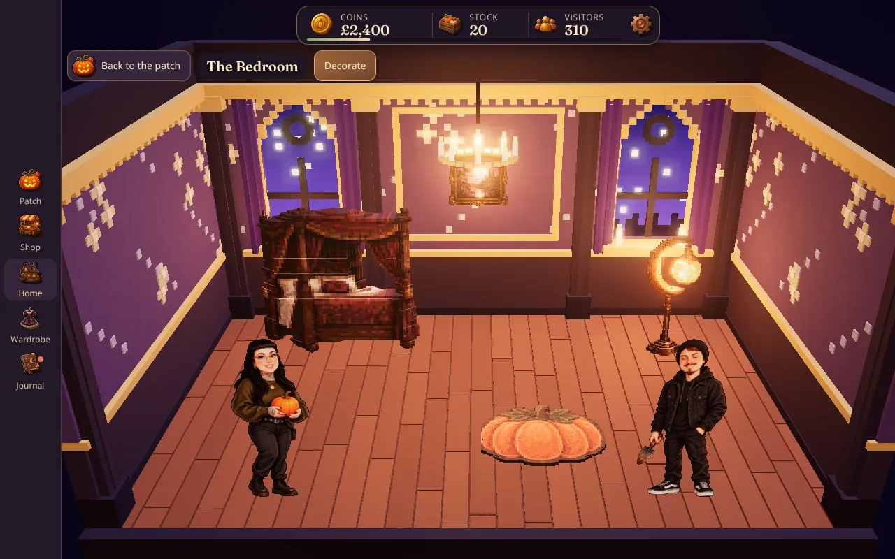
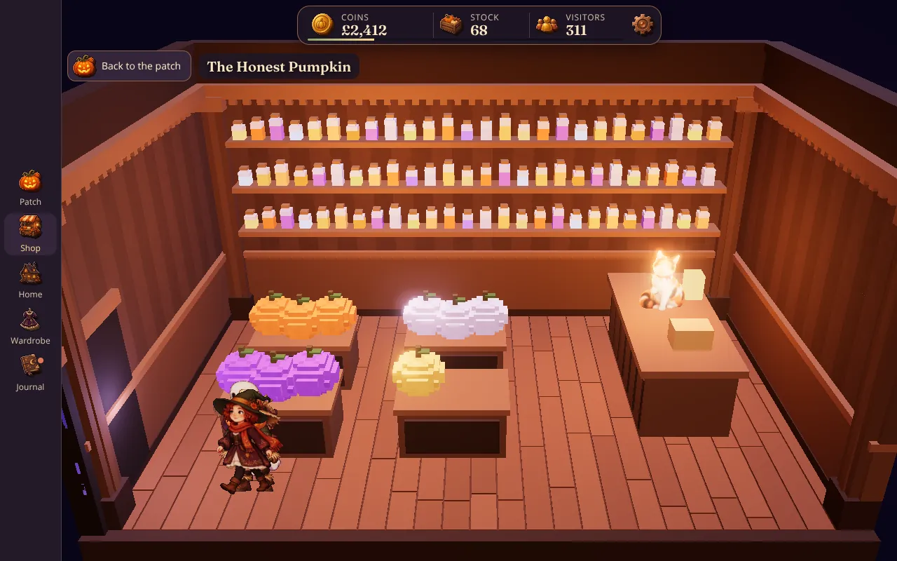
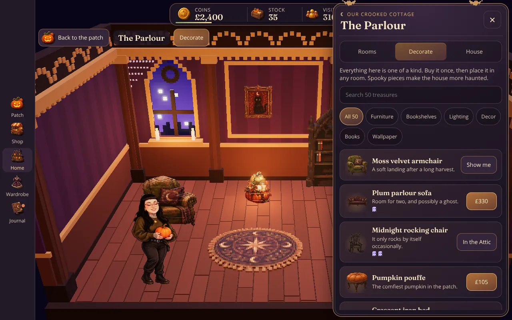
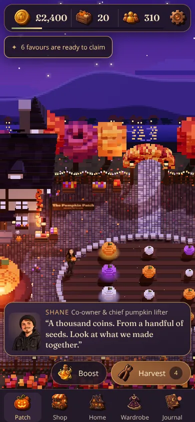
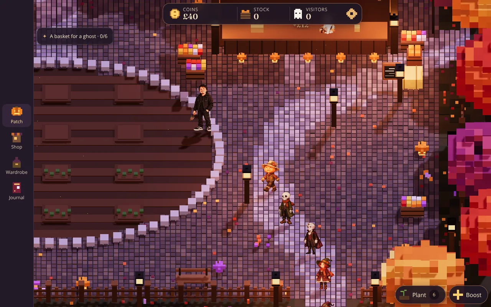
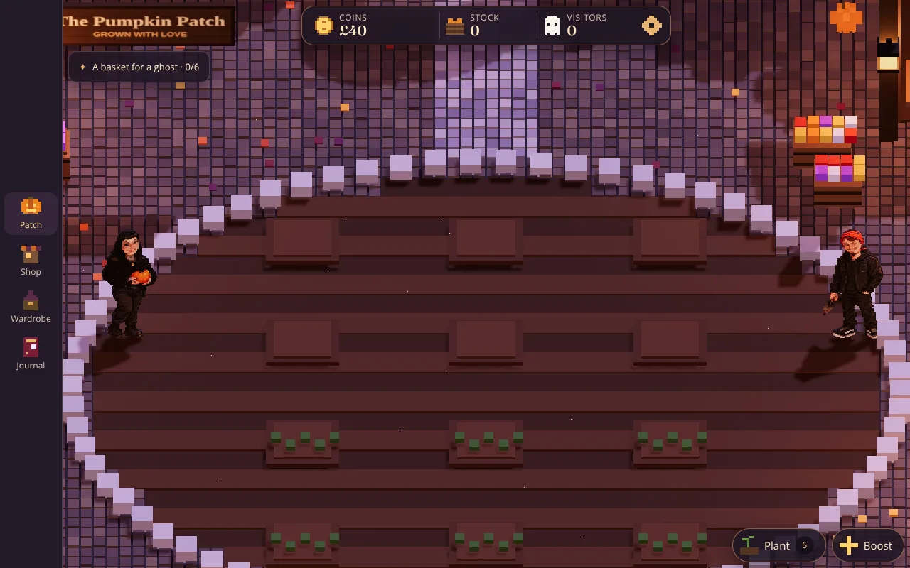
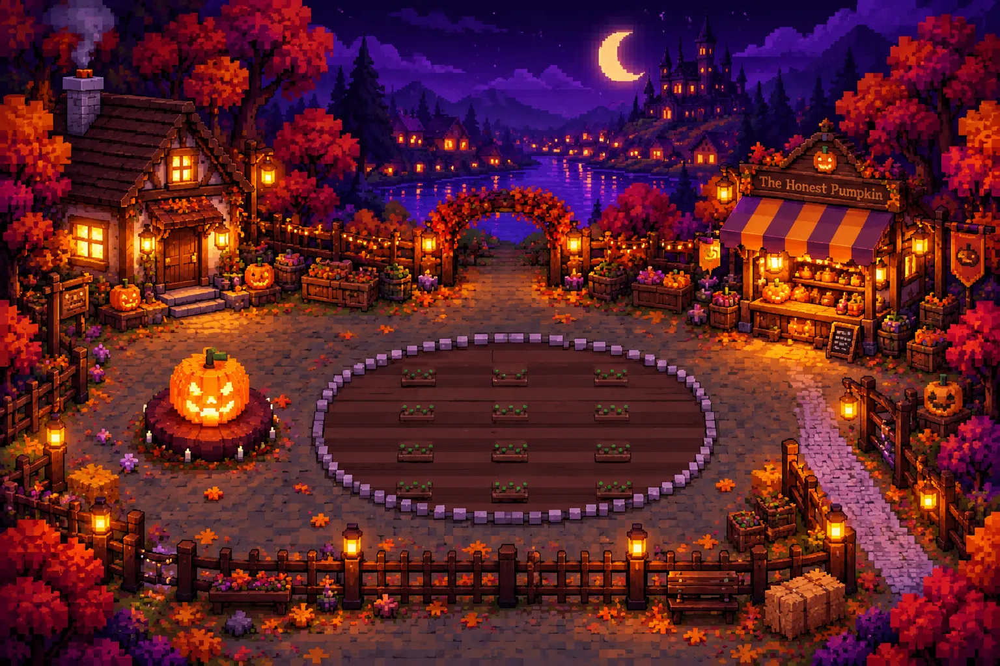

# Pumpkin Patch: voxel reference build

A reimagining of Shane & Natalie's Pumpkin Patch in a **slightly 3D, top-down voxel style**. The world was first built only from [`docs/GAME-BIBLE.md`](docs/GAME-BIBLE.md) (copied here), to test whether the bible is enough to rebuild the game in a different style. It now carries every feature of the main game, rebuilt to suit voxels, and draws on the main game's own art, icons, music and content files. Treat it as a **reference point** for art direction, staging and menu design, not a replacement for the main game.



| The parlour | The kitchen | The celestial bedroom |
| --- | --- | --- |
|  |  |  |

| The shop floor | Decorating | Phone |
| --- | --- | --- |
|  |  |  |

| The original sprites | Voxel characters | The art target |
| --- | --- | --- |
|  |  |  |

```sh
cd voxel
npm install
npm run dev     # http://localhost:8001, rebuilds on change
npm test        # game-rule tests
npm run build   # dist/pumpkin-patch-voxel.html, one offline file (about 5.6 MB)
npm run smoke   # plays the built file in headless Chromium: farm, rooms, decorating, the shop floor, costumes
```

Saves use their own key, `pumpkin-patch-voxel-reference-v1`, so trying this never touches the main game's progress. Saves from the first voxel build load and carry over.

## What's in it

- **The world, laid out as in the bible.** The whole yard fits in one wide shot, framed like the art target:
  - the crooked cottage top left, with lanterns, window boxes and red creeper. It grows with the house: a crooked roof, a second storey, a manor turret, then a haunted haven with a second spire, violet windows, ghost lights and bats.
  - the giant jack-o'-lantern on its candlelit wine-red stage
  - the 12-plot patch in a pale stone oval, in the middle of a cobbled yard (up to 24 plots as the field grows)
  - the lantern walk above the patch, from Skyla's counter to the Hollow House door, where guests cross between the stall and the maze
  - the Honest Pumpkin shop top right: a gable sign, a striped awning, shelves of glowing jars, a row of lit pumpkins, a chalkboard and a banner
  - the lilac stone path the visitors walk, out at the bottom right
  - a leafy arch in the back fence, with string lights, opening onto the lake
  - wooden picket fences with lantern posts, crates, barrels, hay bales, a bench and flowers
  - red, orange and plum autumn trees round every edge
- **The far shore** is painted pixel art on a backdrop that leans back to face the camera: the night sky, a crescent moon, mountains, the castle on its hill, and a lakeside village with its lights reflected in the water. The lake ripples, the village lamps flicker, the reflections glint and the stars twinkle.
- **Mist:** the slightest low mist rolls across the farm from the west, clears for a minute or so and comes round again. It thins over the pumpkins and fades out round the buildings. Mist and the moving lake each have a switch in Settings, and start off on a device set to reduce motion.
- **Lighting:** lilac moonlight casting soft shadows, warm lantern and window light, a bloom glow on everything that's lit, and fireflies.
- **The farm, as in the main game:**
  - Four varieties (Orange, Ruby, Moonlight and Golden), unlocked plot by plot. Each plot grows any variety it has unlocked.
  - Tapping the big pumpkin (or a growing plot) hurries everything growing. With nothing growing, every eighth tap shakes a free pumpkin loose.
  - Picking quickly builds a harvest streak worth a bonus.
  - Upgrades: better tools, bigger harvests, helping hands (Shane and Natalie plant and pick by themselves), more plots, and signs that bring more visitors.
- **Selling, both ways the main game sells:**
  - **The stall.** Neighbours walk up the path, each one of the main game's six shoppers with a budget and favourite varieties. Each fills a basket with favourites first; a favourite they can't afford more of no longer ends the visit, they fill up with something cheaper. The Stall tab keeps a ledger, receipts and who left empty-handed and why.
  - **Demand grows with the farm.** Baskets start at 3 pumpkins and the Bigger baskets upgrade grows them to 10, with a little more in each purse. Party size grows to 50 guests over seven tiers. When the barn is full, a market cart (Build) takes the overflow to the village market for 15 to 35% of the price, up to a set number a minute, so the picking need not stop.
  - **Fresh and wanted pumpkins.** Pumpkins picked in the last 90 seconds are fresh: guests take them first and pay up to 20% more from their change. Every five minutes the village wants one variety you can grow (★ on the seeds tab, a line in the stock panel): up to 25% more, and some guests come with money for one extra. Neither ever costs a sale.
  - **Neighbours' orders.** From level 5, every few minutes one of the regulars asks for a batch of one variety within five minutes and pays a quarter to a half more than the stall. Send it from the stock panel (the crate at the top). Neighbours you send to come back for more and pay better.
  - **The indoor shop.** Open the Honest Pumpkin and step inside: a voxel shop floor with shelves of jars and up to four display tables piled with real voxel pumpkins. Customers come in at the door, browse the tables, queue, and pay Skyla at the till. Upgrades add room to browse, more tables and a faster till.
- **The house, inside.** Tap the cottage, or the Home tab, to step in. Each room is a voxel diorama seen from the front with the front wall lifted away, like the main game's painted rooms. It is built at four times the farm's voxel density so it can carry the detail:
  - **Rooms:** the parlour, bedroom, kitchen and attic, opening as the house levels up.
  - **Ten room styles** after the main game's paintings. Each has its own palette and furniture of the room itself: round, gothic or square windows onto the night, fluted columns, a panelled wainscot, cornice and dentils, curtains, sconces, a chandelier, cobwebs, a hearth with a real fire, shelves of jars, hanging herbs, rafters, a round attic window and fairy lights.
  - **Eight wallpapers** as physical voxels, their motifs (fleurs, moths, constellations, books, vines, ghosts) standing a little proud of the wall.
  - **Fifty treasures** from the main game's catalogue. Each piece is voxelised from its original art, one voxel per pixel. Buy a piece and it is placed; then move it, flip it, send it to another room or put it away. Wall pieces hang on the central panel, lamps and candles light the room, and rugs lie flat.
  - **Free placement.** Pieces drag on a fine grid (or freely), turn to any angle, and collide by their real measured size rather than whole cells, so they stand against the walls, tuck into corners and sit as close to each other as they look.
  - **Things on tables and shelves.** Lamps, lanterns, plants and little curios can stand on tables, desks, bookcase tops and kitchen counters. Select one and tap On a table (Next top moves it on round the room), or tap Move and then a table. Drag or nudge it along the top; it moves, turns and mirrors with its table. Set down puts it back on the floor.
  - **Blank shelves** under Shelves in the catalogue: a floating shelf, a long bracket shelf, a two-tier wall shelf, a corner whatnot and an open étagère, each in six finishes (More › Finish), for things to stand on.
  - **Books** sit in the shelves' own sockets, as the main game's spines, and open in a paged reader.
  - **Levels and haunting:** four house levels raise each room's capacity, and spooky pieces, wallpapers and books add to the haunting score.
- **The cast are the main game's own sprites,** standing in the world as flat cut-outs, the way sprite-in-3D games draw their characters:
  - **Shane and Natalie** are drawn at full size, with the original idle frames (the blink) and six-frame walk cycles. They chat when tapped, and the original dialogue plays at the right moments.
  - **Skyla** has all four of her frames: she looks round, blinks, and reacts when a visitor pays. She sits on the stall counter and on the till inside the shop.
  - **The five neighbours** (Pip, Mabel, Count Bram, Bones and Patch) walk up the path and into the shop with their four-frame walks.
  - **Sizes** keep the original game's proportions: visitors are about two thirds of Shane and Natalie's height.
  - **Lighting:** the sprites are lit by the moon and lanterns and cast shadows the shape of the art. They lean back slightly towards the camera, stretched so the art keeps its exact proportions on screen.
- **The wardrobe:** all thirteen costumes from the main game, classic and 90s Halloween, drawn from their original sheets, plus recolours of Natalie's knit and Shane's beanie.
- **The journal:** the main game's ten midnight favours from the neighbours, a scrapbook of memories with the patch's level, and the library of stories.
- **Voxel characters** (Settings) builds the cast from voxels instead:
  - **Shane, Natalie, Skyla and every costume** are voxelised from the same sprites, one voxel per pixel at 120 voxels tall. Depth is rounded towards the silhouette's edge, and a back is painted on.
  - **The five neighbours** are built by hand from the bible.
- **The introduction:** a new patch opens on a moonlit title card, then Shane and Natalie take turns explaining the farm and the goal over the farm itself (Skip at any time; Settings › Watch again).
- **The Boost button** stays in one place, in the middle of the action bar with a gold ring, whatever Plant and Harvest are doing.
- **Walk through the Hollow House yourself:** once it's restored, Experience (or the maze door in the foyer) takes you on a first-person tour of the maze, with a new chamber per foyer tier. It's free and never touches tickets (Codex, rebuilt by Claude).
  - The doors swing open and you walk at a steady pace, slowing as each scare comes up.
  - The chambers: a passage with a ticking clock, a cobweb cellar, a séance parlour, a storm laboratory and a velvet crypt, each with its own light and fog.
  - Each chamber's name rises as you enter, the screen's edges flash at a scare, the top bar fades while you watch, and the walk ends in warm candlelight with a fright rating.
- **The Hollow House foyer:** a runner leads from the front door to a medallion under the chandelier and on to the maze door, with its lit sign and violet light behind the curtain. The chandelier changes with the lighting finish. The five haunts are cobweb corners with spiders, gilt portraits up the stairs, a parade of ghosts, Tesla coils and a phantom rising from the landing.
- **The Hollow House maze:** opening it sends a small party up the west lane for it. Some guests visit the maze first and then walk the lantern walk to the stall; others buy a pumpkin and walk over to the maze, then go home down the west lane. Sandy's moth courier flutters about her cocoa booth.
- **Music and settings:** thirteen offline MIDI tracks, originals and supplied songs (among them Thriller, Ghostbusters, Disasterology, Crazy Train, Rebel Yell and Nothing Else Matters), on shuffle or picked by hand, with a volume control. Also sound blips, a tea-break pause, render detail, glow, mist, lake and shadow switches, and backups you can copy out and restore.
- **Icons:** the main game's interface icons, baked as small voxel tiles with a darker extruded edge, a light bevel and an outline.
- **Menus:**
  - **Look:** plum panels with brass edges, a crescent-moon heading, small bats on the frame, and gold price buttons. Pumpkin thumbnails are rendered from the real 3D models; decor thumbnails are the original pixel art.
  - **Placement:** sheets slide up on a portrait phone, or in from the side on landscape, the Fold's inner screen and desktop.
  - **Layout rules:** the same as the main game's interface overhaul: the farm stays visible, nothing under 12px or 44px, and a dock or rail for navigation.

## Controls

| Action | How |
| --- | --- |
| Look around | Drag |
| Zoom | Pinch or scroll |
| Plant or harvest | Tap a plot, or press P to plant all and H to harvest all |
| Boost growth | Tap the big pumpkin, or press the space bar |
| Open the shop | Tap the shop, or the Shop tab |
| Go inside | Tap the cottage, or the Home tab; Shop › Step inside for the shop floor |
| Arrange a piece | Tap it, then drag it, or Move and tap a spot, or use the arrow keys. F flips it, Delete puts it away |
| Stand something on a table | Select a lamp or curio and tap On a table, or Move and tap the table |
| Chat | Tap Shane or Natalie |
| Close a menu | Escape |

## Code

| File | What it holds |
| --- | --- |
| `src/model.js` | Puts the game state together, loads old saves and runs one step of the rules. No DOM and no three.js, so `test/` runs it in Node. |
| `src/rules/` | The rules, one file each: `farm.js` (plots, varieties, upgrades, streaks, the barn and market cart), `stock.js` (stock, fresh pumpkins and baskets), `market.js` (fresh and wanted pumpkins), `orders.js` (neighbours' orders), `selling.js` (the stall and the indoor shop), `house.js` (levels, rooms, decor placement, books, wallpaper, styles, pieces on tables), `surfaces.js` (the tops things stand on), `wardrobe.js` and `progress.js` (favours, memories, levels). They read the main game's content files in `../src/content/` directly. |
| `src/voxels.js` | Box batching: every box sharing a material becomes one instanced draw call. |
| `src/world.js` | The map: terrain, cottage (in four stages), shop, path, fences, arch, trees, props and the painted far shore. Layout constants live here. |
| `src/interiors.js` | The rooms and the shop floor at four times the density, the ten styles, the eight wallpapers, and decor voxelised from the original art. |
| `src/places.js` | Inside places: builds the room or shop floor, places decor, walks customers from the door to the till, and highlights pieces while decorating. |
| `src/sprite-actors.js` | Shane, Natalie, Skyla, the costumes and the visitors drawn with the original sprites, and their portraits for the menus |
| `src/sprite-voxels.js` | The voxel characters: sprite frames turned into voxel meshes. Also the frame animation and recolours both kinds share |
| `src/characters.js` | The visiting neighbours built by hand from voxels, with legs that swing |
| `src/scene.js` | Renderer, lights, bloom, the farm's camera and the rooms' perspective camera, input, and the per-frame animation |
| `src/ambience.js` | The drifting mist and the far shore's moving lake and lights, as shaders on a few uniforms. Its timing is in `src/content/ambience.js` |
| `src/main.js` | Save and load, dialogue, the HUD, the dock, and which menu is open |
| `src/ui/` | The menus: `farm-sheets.js` (Shop), `home-sheets.js` (Home and the piece bar), `collection-sheets.js` (Wardrobe, Journal, the reader), `settings-sheet.js`, `audio.js` and shared bits in `kit.js` |
| `assets/`, `src/sprite-meta*.js`, `src/decor-meta.js`, `src/icons.css` | The sprite sheets (full size and small), costumes, decor art and icons, baked from the main game's art. Regenerate them all with `python3 voxel/tools/bake_sprites.py` from the repo root (about two minutes) |

## Not in it (yet)

Flex Mode for the Fold half-open. The build is also larger than the main game's, mostly because of the thirteen full-size costume sheets.
