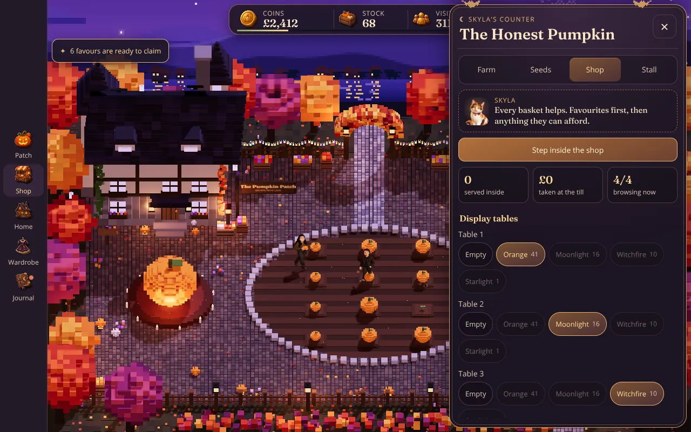

# Pumpkin Patch: voxel reference build

A from-scratch reimagining of Shane & Natalie's Pumpkin Patch in a **slightly 3D, top-down voxel style**. It was built only from [`docs/GAME-BIBLE.md`](docs/GAME-BIBLE.md) (copied here), to test whether the bible is enough to rebuild the game in a different style. Treat it as a **reference point** for art direction, staging and menu design, not a replacement for the main game.


| Close up | Phone | Shop menu |
| --- | --- | --- |
|  |  |  |

```sh
cd voxel
npm install
npm run dev     # http://localhost:8001, rebuilds on change
npm test        # game-rule tests
npm run build   # dist/pumpkin-patch-voxel.html, one offline file (about 750 KB)
npm run smoke   # plays the built file in headless Chromium and checks for errors
```

Saves use their own key, `pumpkin-patch-voxel-reference-v1`, so trying this never touches the main game's progress.

## What's in it

- **The world, laid out as in the bible.** Everything is voxels in one night scene:
  - the crooked cottage top left
  - the giant jack-o'-lantern on its candlelit stage
  - the 12-plot patch in a stone-edged oval
  - the Honest Pumpkin shop with its striped awning, shelves of glowing jars, the till and the bell
  - the stone path the visitors walk
  - string lights, lantern posts and a fence
  - autumn trees, distant hills, a castle and the moon
- **Lighting:** lilac moonlight casting soft shadows, warm lantern and window light, a bloom glow on everything that's lit, and fireflies.
- **The cast, built part by part from the bible:**
  - **Natalie:** baby bangs, gold glasses, blue eyes, gold hoops, neck tattoo, olive knit, grommet belt, charcoal jeans, yellow-stitched boots, and a pumpkin in her hands.
  - **Shane:** black beanie, auburn hair and goatee, black hoodie under a washed-black denim jacket, cargo trousers, skate shoes with cream soles, and a rusty trowel.
  - **Skyla:** a calico cat with a burgundy collar and pumpkin bell, sitting on the counter.
  - **The five neighbours:** Pip, Mabel, Count Bram, Bones and Patch.
- **The loop:**
  - Plant, grow, harvest. Tap the big pumpkin to hurry growth.
  - Visitors walk up the path to Skyla's counter and buy the best pumpkin they can afford.
  - Spend coins on upgrades, better seed varieties and recolours.
  - Claim favours from the neighbours.
- **Menus:**
  - **Look:** plum panels with brass edges, a crescent-moon heading, small bats on the frame, and gold price buttons. Pumpkin thumbnails are rendered from the real 3D models.
  - **Placement:** sheets slide up on a portrait phone, or in from the side on landscape, the Fold's inner screen and desktop.
  - **Layout rules:** the same as the main game's interface overhaul: the farm stays visible, nothing under 12px or 44px, and a dock or rail for navigation.

## Controls

| Action | How |
| --- | --- |
| Look around | Drag |
| Zoom | Pinch or scroll |
| Plant or harvest | Tap a plot |
| Boost growth | Tap the big pumpkin, or press the space bar |
| Open the shop | Tap the shop |
| Chat | Tap Shane or Natalie |

## Code

| File | What it holds |
| --- | --- |
| `src/model.js` | Game rules. No DOM and no three.js, so `test/` runs it in Node. |
| `src/voxels.js` | Box batching: every box sharing a material becomes one instanced draw call. |
| `src/world.js` | The map: terrain, cottage, shop, path, fence and props. Layout constants live here. |
| `src/characters.js` | Shane, Natalie, Skyla and the visitors, with legs that swing |
| `src/scene.js` | Renderer, lights, bloom, camera, input, and the per-frame animation |
| `src/main.js` | Save and load, goals, menus, and the HUD |

## Not in it (yet)

Room interiors, full costume outfits, books, the indoor shop with customers inside, and Flex Mode.
