# Cooking, deliveries and 20 levels — implementation roadmap for Claude

Status: **designed, not implemented**. This is the next contractor programme, after the playable meadow/Sandy/customer-care delivery. The current HTML still has the existing 12-level progression. Do not advertise cooking or levels 13–20 as playable until their source, save migration and end-to-end tests land.

## Player loop and level-5 access

At **level 5**, the player earns permission to **purchase** a small food truck. Levelling up does not spend coins or spawn it. Proposed introductory price: £900, to tune alongside the separate £650 cocoa purchase. After buying it, tapping the truck opens Cooking, with tabs for Recipes, Deliveries, Pantry and Finished food.

The truck provides a starter preparation station. The same Cooking page can be opened by tapping a placed cooker in the home kitchen; both use one shared home pantry and finished-food store. A kitchen cooker can become a second station once the kitchen/room is available, avoiding a level-5 dead end if the player has not yet bought that room. The truck is a compact voxel building beside the shop, visibly smaller than the shop, with a serving window, cooker, warm task lighting and a tiny menu board. It is not a large modal browser page floating over a disconnected minigame.

```mermaid
flowchart LR
  A[Ingredient market: pay for an order] --> B[Timed delivery queue]
  B --> C[Voxel cart enters from north]
  C --> D[Shane or Natalie unloads]
  D --> E[Shared home pantry]
  E --> F[Food truck or home cooker]
  F --> G[Recipe cooking job]
  G --> H[Finished-food inventory]
  H --> I[Assign a real shop shelf]
  I --> J[Hungry visitor buys within budget]
  J --> K[Profit, recipe mastery and unlocks]
  K --> A
```

## A physical delivery rather than an instant inventory purchase

Orders have a quoted ingredient total, delivery fee, parcel size and arrival countdown before confirmation. Proposed starter delivery: **60 game seconds**, including the final drive/unload. Tea break pauses it, consistent with current rules. Offline progression is a separate, later feature; do not mix wall-clock deadlines with game-time jobs in this first release.

Each order advances `ordered → travelling → unloading → delivered`, with a stable order ID. The last part of the wait is visible: a small voxel cart enters **from the north/top**, through a service gate, drives along a marked service path and stops at a receiving point. Shane or Natalie approaches and unloads it. Only when unloading completes are the raw ingredients credited to the home pantry, exactly once. A delivered order cannot be credited again after save/reload. The cart leaves along its service route.

Start with one active delivery and a small waiting-order limit. If the pantry is full, the cart holds sealed parcels at the receiving bay; show why and let the player free space. Never delete paid ingredients. Cancel only before dispatch, with the refund shown before confirming. Chef/courier upgrades can shorten waits or combine deliveries later; they do not create free ingredients.

## World allocation and visual contract

Reserve an approximately **4.5 × 2.7 world-unit** pad immediately beside the shop, plus a narrow receiving bay and a walking apron. A provisional location is the north-west part of the purchased meadow: **x41–45.5, z2.4–5.1**. Claude must check this against its current unpublished shop/fixtures before fixing coordinates. The truck is smaller than the main shop and Sandy’s pavilion.

The visitor exit at z6.6 must stay open, with clearance for the route’s full width; no truck wheels, awnings, delivery crates, signposts or tails over that path. Open a separate service gate in the north boundary and use an explicit cart route to the receiving bay. Reserve the cart’s whole swept rectangle, not only its centreline. The entrance from the top must be visible in the default camera and the Fold wide view.

Use the original yard ground generator, fence/tree palette and voxel density. Keep the original departure and service routes as shared data that terrain and actors both read. If delivery movement crosses a visitor path, use a short yield/wait at the junction. Do not let the cart run through visitors or through the shop mesh. A saved vehicle is reconstructed from order phase/progress; no fragile scene-object IDs in the save.

## Pantry, cooking and selling rules

- **One pantry:** `pantry.items[ingredientId]`, capacity and reserved quantities. Home, truck and market pages show the same quantities. The farm’s pumpkin inventory is an ingredient source through `available()`; queued shopper holds cannot be taken for cooking.
- **Recipe definitions:** ingredient amounts, required appliance, cook time, batch yield, unlock ID, base food value, image/model ID and optional research condition. First version has no food spoilage; add it only if later playtests show it improves the game.
- **Cooking transaction:** reserve all inputs atomically when starting, then consume them according to one documented cancellation rule. A cooking job owns its reservation; another cooker, sale or save/reload cannot consume it twice. A full finished-food store pauses completion visibly instead of losing output.
- **Meaningful appliances:** a food-truck starter hob makes simple dishes; a home cooker/oven opens baking and a second queue. Upgrades improve batch size, speed or reliability rather than multiplying sale prices without limit. Both stations share the same ingredient locks.
- **Research:** a recipe opens when its patch level is reached **and** its research/sample requirement is met. Show a preview and exact requirements. Research consumes a defined sample/cost once and records an unlock ID.
- **Finished food:** separate stock from raw ingredients and pumpkins. Food is assigned to actual shop display/shelf slots, including the wall shelves requested earlier. The world shows appropriate miniature dishes or jars; assign/clear/change uses the existing shop workflow.
- **Customers:** extend the live guest needs model. Hungry visitors consider stocked foods, taste, quality, posted price and remaining money; thirsty visitors consider drinks. Reserve a food item before queuing. Every food purchase shares the same finite purse as cocoa, pumpkins and tips, and uses separate product/tip ledgers.
- **Balance:** count a pumpkin’s lost sale value in recipe costs. A proposed wedge recipe using one £12 Orange pumpkin plus £3 ingredients cannot be treated as £3 total cost. Example starter dish: £15 effective inputs, £22 default sale, 30s cooking; proposed pie: £34 effective inputs, £58 sale, 75s. These are tuning targets, not live prices. Higher-value foods need time, ingredients and actual demand.

## Proposed 20-level progression

Keep the existing **level 1–12 earnings thresholds and already-granted rewards**. In particular, do not move/remove the existing Freddy/Jason level-12 rewards from returning players. Add cooking unlock IDs alongside these milestones, then append levels 13–20. Proposed new thresholds are shown below; run a stock/demand/throughput simulation before accepting late-game prices.

| Level | Earnings threshold | Cooking / business goal |
| ---: | ---: | --- |
| 1 | £0 | Learn planting, harvesting, finite stock and the farm stall. Preview the locked Cooking feature. |
| 2 | £150 | First upgrade and delivery/pantry preview; no cooking purchases yet. |
| 3 | £500 | Valuable seeds and visitor preferences; preview recipe ingredients from pumpkins. |
| 4 | £1,000 | Buy meadow land and reserve compact business pitches. |
| **5** | **£2,200** | **Unlock purchase of the food truck and cocoa shop separately.** Truck purchase opens pantry, ingredient market, timed cart delivery, roasted wedges and pumpkin soup. One food shelf becomes assignable. |
| 6 | £4,500 | Research toffee apples; buy apples/sugar. Tier-2 cocoa menu remains its own purchase path. |
| 7 | £8,500 | Research pumpkin jam; preserve jars and a second food shelf. First recipe mastery challenge. |
| 8 | £15,000 | Research s’mores and ghost biscuits; chocolate/marshmallow ingredients. Tier-3 cocoa remains a paid upgrade. |
| 9 | £26,000 | Kitchen cooker research; home cooking station if the kitchen is owned. Learn spiced pancakes. |
| 10 | £42,000 | Oven upgrade and pumpkin pie; ingredient-delivery capacity tier. |
| 11 | £70,000 | Moon-mint tea and berry preserves; unlock herb/berry suppliers or later produce patches. |
| 12 | £110,000 | Cauldron stew and the first small catering order. Preserve all current level-12 costume rewards. |
| 13 | £170,000* | Batch cooking, two queued jobs and pumpkin bread; explicit store/pantry capacity upgrade. |
| 14 | £260,000* | Research witchberry crumble and haunted kitchen biscuits; better ingredient sourcing. |
| 15 | £390,000* | Express delivery cart, consolidated parcels and caramel ghost cakes. |
| 16 | £575,000* | Hire a spooky chef: automate one learned recipe at a chosen stock target. No automatic ingredient buying by default. |
| 17 | £825,000* | Two appliance stations work in parallel, shared reservations; savoury midnight pot pie. |
| 18 | £1,150,000* | Seasonal menus and optional visitor catering contracts; new food-truck skins. |
| 19 | £1,550,000* | A high-tier festival banquet recipe, larger visitor food demand and chef specialisation. |
| **20** | **£2,000,000*** | Gourmet Halloween festival: a final recipe collection goal, master-chef cosmetic and a repeatable festival cycle. Continue decorating and collecting; no forced save reset. |

\* Proposed thresholds for implementation review, not applied to the current game.

Unlock progress is visible in the existing compact top level indicator and level-up celebration. A locked recipe shows the next actionable goal. Mix level milestones with recipe mastery, fulfilled orders and research so the whole loop is not only “wait for a larger coin total”. Keep one-time unlock/reward IDs stable through migration. Do not award every past recipe’s coins again to an old save when levels expand.

## Chef automation with player control

The chef is a late-game paid hire, not free passive revenue. The player chooses an unlocked recipe, target finished-stock count and minimum pantry reserve. The chef starts a job only if an appliance is available, ingredients are truly available and output capacity can accept the batch. A separate opt-in purchasing plan may later order ingredients under a spend limit and reserve balance. Never spend on deliveries while the player has only enabled cooking. Pause, order failures, full stores and missing ingredients are explicit states with short UI explanations.

## Module boundaries / save contract

| New module | Responsibility |
| --- | --- |
| `content/recipes.js`, `content/ingredients.js`, `content/cooking-unlocks.js` | Stable IDs, recipe data, supplier prices, progression definitions. |
| `rules/pantry.js` | Shared raw stock, capacity, per-job reservations and release/consume operations. |
| `rules/deliveries.js` | Paid orders, game-time ETA, delivery/unload phases, exactly-once receipt, save repair. |
| `rules/cooking.js` | Appliance queues, recipe gates/research, input/output transactions and job completion. |
| `rules/food-retail.js` | Finished stock, display assignments, food holds, budget-aware checkout and ledgers. |
| `rules/chef.js` | Explicit target-driven automation over the same public cooking/order actions. |
| `food-truck-world.js`, `delivery-cart-world.js` | Native voxel models and visual movement; read state, never credit ingredients or coins. |
| `ui/cooking-sheet.js`, `ui/pantry-sheet.js` | Recipes, deliveries, pantry and output controls; cooker/truck map picks open the same model. |

Use `model.update` to advance delivery and cooking rules and emit events for animation/sound. The renderer may not decide that an order is delivered or a meal is sold. Bump the save schema when implementation lands, preserve this delivery’s cocoa/customer-care fields, migrate old saves into locked/empty cooking state and validate all item IDs, quantities, ownership and pending reservations. Save jobs/orders as plain IDs, amounts, elapsed time and phase; rebuild carts/stations from those records.

## Contractor work packages and acceptance

1. **Pantry + one complete delivery + one recipe.** Buy truck at level 5, order ingredients, see the north-entry voxel cart, see a co-owner unload, cook a dish and retain it in finished stock. A complete first vertical slice, not disconnected draft modules.
2. **Home cooker + real retail shelf.** The same pantry feeds truck/home queues; put cooked dishes on the actual shop shelf and sell to a hungry budget-aware visitor. Profit and tips reconcile separately.
3. **Recipe research + levels 13–20.** Preserve returning players’ level-1–12 rewards; demonstrate unlocks, research, cooking and a saved late-game queue.
4. **Chef + capacity + balancing.** Add explicit stock targets, spend limits for any later purchasing automation, throughput/demand simulation and late-game goal playtests.
5. **Art/UI polish.** Food truck, cart, parcel variants, appliance animations, individual food/jar props, readable menus and Fold/fullscreen QA. The truck must not obscure Skyla, the visitor exit or the delivery junction.

Every completed work package gets a separate reviewable commit or patch, a README/handover naming exact integration hooks, rule/save tests, desktop/phone/Fold screenshots and a fresh standalone HTML. Required checks include pause/resume and reload during every delivery/job phase; duplicate completion events; full pantry/output stores; insufficient coins/ingredients; competing shop/customer/cooking holds; a recipe cancellation; empty food shelves; chef reserve limits; and a delivery route that yields at visitor crossings. Claude remains responsible for reconciling the contractor patch with its current unpublished world/fixture changes.
