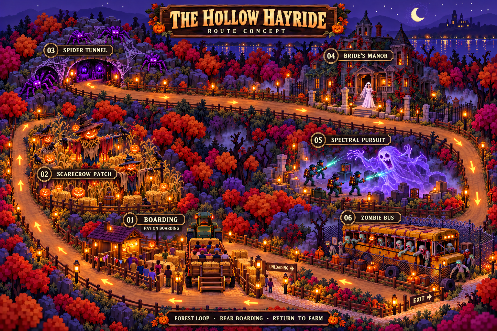
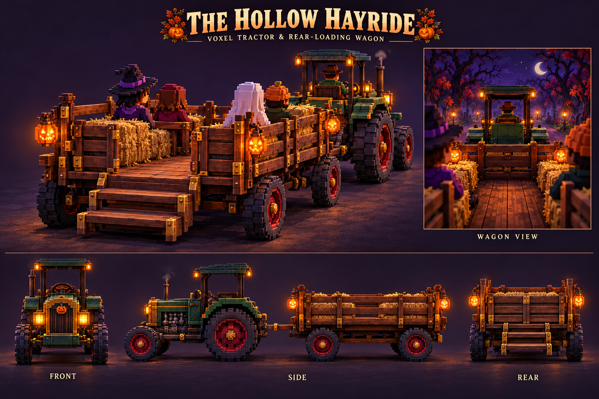

# 32 — The Hollow Hayride: second scare attraction roadmap

For **Claude, the lead developer**. Status: **design, generated concepts and a standalone native voxel vehicle prototype; not integrated into the playable game**. This contractor part extends the [twenty-level roadmap](09-cooking-and-twenty-level-roadmap.md), alongside the existing Hollow House and its [first-person experience](29-first-person-maze.md). It changes no live runtime, saves, prices or unlocks. The user's follow-up makes a **ride-along experience a required feature**, not an optional stretch goal.

Source branch: `contractor/first-person-hollow-house`, following `49e11cb`. This part touches only `voxel/docs/`; review its commit separately if the preceding maze delivery has already been integrated. Preserve Claude's unpublished work and do not merge a downloads-only artifact branch into game source.

## Player promise and concept map

Buy a woodland attraction, watch visitors climb into a hay wagon behind an old tractor, take their ticket money **when they board**, and send them through a complete Halloween scare circuit. The farm gains another reason to visit, while returning riders may still buy pumpkins, cocoa and eventually cooked food from their remaining money.

**The image is a route and art-direction proposal, not an as-built terrain plan.** Its landmark numbers map to the table below. World coordinates, gradients, vehicle clearance and connection to Claude’s current farm need a measured layout pass before implementation.

The map uses the existing voxel farm as its visual reference: plum night, lilac moonlight, chunky autumn trees, warm lanterns and recognisable voxel construction. The sets should become native voxel models, with painted actors in the established visitor style. The latest user brief adds stronger Shocktober horror to the original cosy game bible; retain the gentle/reduced-motion option already used by the maze.

## Route and encounter sequence

One continuous clockwise loop, with no ride-lane crossings. A short spooky forest approach separates boarding from the first reveal. Trees and fog screen the next set, so the whole attraction is not visible at once from the ride camera.

| Map | Stop | Scene and movement |
| --- | --- | --- |
| **01** | **Boarding station** | Timber queue, lantern ticket post and rear-loading wagon. The tractor faces away along the outbound lane, with the wagon correctly coupled behind it. From the farm-side camera, players see the back of the tractor and the wagon’s rear boarding gate and steps. Guests pay as they take a free seat. A separate unloading bay feeds a pedestrian exit before the next boarding cycle. |
| **02** | **Haunted pumpkin scarecrow patch** | The lane passes close to dead pumpkin vines and crooked scarecrows. Pumpkin eyes kindle, one head turns and a concealed scarecrow straightens into view. Retreat into the stalks before the wagon passes its clearance envelope. |
| **03** | **Spider tunnel** | A low rock-and-timber tunnel closes around the lane. Webs catch cold violet light, small spiders scuttle and a larger spider lowers beside the wagon. Two portals and a continuous route through the tunnel; no teleport. The concept map may cut away the roof for clarity, but the ride view is enclosed. |
| **04** | **The bride’s decrepit mansion** | A ruined Victorian facade, broken porch, ivy and dark windows. A bride in a long white dress and trailing veil walks out of the doorway towards the lane, pauses in a warm/cold light change and recedes into shadow. Keep her a consistent animated character, not a static sign. |
| **05** | **Spectral pursuit** | An original paranormal-investigator team chases a billowing **purple gas ghost** across a forest clearing. Copper equipment, restrained energy arcs and a ghost that compresses, swells and retreats behind the trees. Keep the requested ghost-busting scene without borrowing a franchise logo or replacing the game’s cast. |
| **06** | **Zombie prison bus** | A decrepit barred prison bus behind broken chain-link fencing. Zombies reach through windows; one emerges beside the bus and lurches towards the wagon. Red warning light and a short metal rattle, then the lane bends back towards the station. No actor or bus mesh intersects the vehicle. |

After scene 06, guests unload, walk through the exit gate and visibly rejoin the farm paths. Keep the admission queue separate from the returning crowd. Each scene has an approach, reveal, close pass and retreat; a scare trigger fires once per convoy pass, not every render frame.

## Native voxel tractor and wagon design

Use a compact vintage **pine-green tractor**, burgundy wheel hubs, brass grille, pumpkin bonnet badge, open driver seat beneath a small canopy, exhaust chimney and warm amber lamps. Large treaded rear wheels and smaller front wheels must read as working machinery. Couple a **walnut hay wagon** behind it with brass brackets, two inward-facing side benches for four passengers, a clear central footwell, rear boarding gate and steps. Small pumpkin lanterns identify the back corners without making the whole model emit light.

The [standalone native voxel prototype](../contractor-patches/haunted-hayride/prototype/README.md) is the code starting point for Claude to inspect. It is separate from the live world. Use its measured pivots/anchors and bounding dimensions when allocating the lane, then refine against the generated turnaround. The sheet is an art reference rather than a dimensioned engineering drawing: native collision and seat data take precedence over incidental image details. No flat image should substitute for the tractor in the 3D farm.

Build tractor, wagon, wheels and gate as separate reusable assemblies. Root pivots are at ground/chassis reference positions; coupling, rear steps, seats and ride camera have named anchors. Wheel roll derives from distance travelled, steering follows the curve, and the wagon trails the tractor along the route rather than rotating as a rigid train through corners. Keep all box dimensions positive and finite; use cached instancing and the existing fixed light pool.

## Required player ride-along experience

Tapping the station opens a compact context card with **Ride along**, Manage and Upgrade. After purchasing the attraction, the owner can take a **free preview** even while ticket admissions are closed. This owner experience creates no visitor, seat hold, ticket, XP or earnings. It must not duplicate the paying convoy's simulation. A future live-departure spectator mode can follow an existing `runId` read-only, but is not needed for the first complete ride-along.

The opening camera shows the rear gate and boarding steps, then eases to a seated passenger viewpoint near the rear of the wagon. Look forwards between the side benches towards the **back of the tractor**, with fellow rider silhouettes and the lane ahead framing the view. Use a named seated camera anchor, approximately 1.1–1.4 units above the wagon floor after scale review. Dragging looks left/right and slightly up/down; no pointer lock or free-walk controls. The vehicle remains properly coupled when looking to the sides.

The same continuous route takes the owner through **every requested set**, with a short forest lead-in, shallow visibility, warm/cold pockets of light and spatially timed actor reveals. The spider descends beside the wagon, the bride approaches from her porch, the gas ghost briefly swells near the lane and zombies lurch from the bus. Actors retreat outside the swept envelope before the wagon reaches them. Reveal timing derives from route distance, with bounded one-shot cue IDs. Cap/substep the owner playback clock after a long frame so a reveal remains visible instead of jumping past a whole scene. Autonomous convoy rules may advance the full game-time delta while recording each crossed trigger once; they must not depend on the owner camera's slower presentation clock.

Keep a small **Exit ride** control available throughout. A brief look hint fades away; the farm dock, decoration controls and routine notifications are hidden during the experience. Escape/pause and tab visibility follow the existing maze lifecycle, with explicit Resume after interruption. Exit immediately restores the previous farm camera and input ownership. A completion card can offer Ride again and Return to farm, without claiming another paid ticket.

Reuse the single renderer and audio context. Fade/duck music under tractor rumble, distant forest sounds and local scare cues; cap simultaneous voices. Gentle mode removes jolts, reduces close lunges and keeps the wagon camera steady. No strobe or forced rapid shake. Normal farm rules continue under their existing pause policy. Starting, replaying or leaving the owner experience makes no direct changes to ticket totals, guest positions or farm-save state beyond that ordinary background simulation.

## Site allocation and farm connection

Propose a separately purchased **woodland clearing adjoining the public farm**, not the private homestead through Shane and Natalie’s central hedge arch. Keep The Hollow House on its current public plot. The hayride’s ruined mansion is a scenic set, not another entrance to either house.

Claude should select the connection after inspecting its current unpublished map work. Do not paste the illustration’s coordinates into the world: the current west bound is limited, the east meadow has businesses, and the cooking roadmap reserves a service route and delivery pad. Reserve the station, eight-person queue, unload apron, pedestrian approach, full vehicle swept envelope and all scenery bounds together. Expand ground, fences, trees, camera/pan limits and picking bounds from shared layout data.

Queue approaches and exits remain visibly connected. Preserve `DROP`, `HOLLOW_LINK`, `counterPlace(spot)` and `hollowLinkFrom(place)`; a guest leaving Skyla starts at their actual counter position. Use a pedestrian crossing with a yield rule only where unavoidable. No shortcut across the pumpkin patch, no return to the old Hollow House off-map transfer phases. Hide distant woodland chunks for rendering efficiency without removing their simulated riders.

## Progression proposal — prices require balancing

**Proposed purchase unlock: patch level 8**, after the Hollow House has been restored at least once. That is permission to buy, not a free attraction. Preview it after opening the first attraction. Keep existing cocoa purchase at level 5, Hollow House purchase at level 6, level rewards and returning players’ ownership intact.

For economy simulation, start with **£7,500 including the clearing and complete basic ride**, an **£8 default ticket** adjustable within a proposed £4–£12 starter band. These are test inputs, not approved/live prices. Compare demand, shared guest budgets and competing farm upgrades before setting the final costs.

| Tier | Proposed patch level | Paid improvement |
| --- | ---: | --- |
| 1 — The first fearful circuit | 8 | One tractor, four-seat wagon, eight-place queue, all five requested scare sets and a complete return loop. |
| 2 — Lantern convoy | 10 | Six seats, twelve queue places, covered boarding, richer lanterns and improved loading. Recheck the longer wagon’s entire swept envelope. |
| 3 — Midnight procession | 12 | Eight seats, sixteen queue places, more detailed sets, alternate actor reactions and a grand station skin. |
| 4 — Shocktober special | 15, future twenty-level release | Premium scene variants, stronger controllable theatrics, cosmetic tractor/wagon finishes and a collection goal. This tier depends on the separate levels 13–20 work. |

All requested landmarks belong in the first finished ride. Upgrades improve capacity, efficiency, scares and appearance. Avoid a starter attraction that is just a station with promised scenery. Leave repeatable tier prices unset until the demand simulation runs; do not increase ticket value, vehicle speed, seats and footfall exponentially together.

## Boarding, departures and money

Initial tuning: one convoy, roughly **90 active game seconds** around the circuit, about 1.5 seconds to board each guest, and a short unload phase. Depart when full, or 15 seconds after the first guest boards; never send an empty convoy. The queue timer continues while the convoy is away, with enough patience for at least one complete circuit. Tea break pauses the rules. Background operation uses these same timers when the player views another place.

Guest visit: `approach → queue → boarding → riding → unloading → return/home`. Convoy: `unloading → loading → departing → circuit → arriving`. The guest keeps the same identity, wallet, needs and total capacity slot throughout. A guest cannot simultaneously queue for another attraction or stand at the shop till. A group can wait for enough seats or explicitly accept splitting; never silently charge guests left on the platform.

1. Joining the queue records a stable visit ID and the quoted ticket price. It creates no revenue. Changing the posted price affects new joins only.
2. Immediately before boarding, check that the attraction is accepting that guest, the convoy is safely stationary, a seat is free and the guest still has spendable money.
3. Commit the seat assignment, wallet debit and receipt together. Store `visitId`, `runId`, guest ID, seat ID and actual amount. Repeating this boarding action returns the existing receipt without another debit or sale event.
4. Spendable money excludes unpaid basket/food holds and **unspent wanted-pumpkin wish money**. The existing guest budget can contain that restricted wish purse; it is not hayride cash. Do not mint another allowance on each queue attempt.
5. Unaffordable guests, full queues and voluntary departures use the visible exit without payment. Closing stops new boarding; already paid riders finish their circuit. Define and test a single exceptional refund path if the ride must be cancelled after payment.

Report hayride tickets, visitors served, queue abandonments, occupancy and earnings separately from Hollow House tickets, retail receipts and **tips**. Reconcile these with the shared total; never record the same ticket as a sale at boarding and again on return. Keep the existing Hollow House optional repeat contract: a repeat is a new visit/payment, while one visit is charged once.

Scares raise each rider’s terror relative to bravery. Enjoyably scared visitors may shop, recommend the farm or choose a later ride; overwhelmed riders finish safely, then head home. Nobody jumps out of the moving wagon. Avoid guaranteed repeat purchases and infinite paid requeues. Any attraction footfall bonus shares an explicit bounded policy with the existing maze and harvest-rush boosts, and respects the total visitor cap.

At four riders, £8 and roughly 100 seconds per full cycle, theoretical revenue is about **£19 per minute before demand limits**. Partial wagons, walking/queue time and finite wallets lower it. Test this alongside pumpkin, cocoa, wanted/fresh premiums and orders before tuning unlock costs; that ceiling is not a promised earning rate.

## Implementation boundaries for Claude

Suggested modules, subject to the current lead architecture:

- `content/hayride.js` and `content/hayride-route.js`: stable tiers, stop IDs, route version, waypoints, station/clearance data and trigger distances.
- `rules/hayride.js`: purchase/open gates, queue, seat/receipt transaction, dispatch, progress, outcomes and background updates. Pure rules under `model.update`; no renderer callback pays money.
- `hayride-world.js`: batched native scenery, tractor/wagon models, queue hit areas and scene animations. Render guest seats from the authoritative manifest; do not duplicate their walking sprites.
- `hayride-view.js`: required free owner ride-along from the wagon, looking forwards towards the tractor, with bounded touch look, Exit, gentle motion and existing audio lifecycle. This view reads a route snapshot and creates no paying guest, receipt or XP.
- `ui/hayride-sheet.js`: compact context card for Open/Closed, seats/queue, ticket price and earnings; deeper upgrades only when requested. Reuse premium icons/tokens and 44px touch targets.

One route definition drives track dressing, vehicle interpolation, camera and encounter trigger positions. Derive wagon rotation and drawbar articulation from distance along the curve; keep speed continuous and bends broad. Use cached voxel batches, fixed light pools, bounded particles and original scare sounds. Reuse the renderer, pause/focus/audio ownership patterns from the first-person maze. Do not load a second WebGL context or rebuild the forest every frame.

Save only plain state: ownership/tier, posted price, convoy phase/progress, active guest visits, seat manifest and receipts, with a validated route version. **Ordinary `visitors` are not saved today; `saveHollowVisitors` explicitly preserves unfinished maze visits.** Add equivalent hayride persistence or a reconciled shared active-visit envelope; otherwise paid riders disappear on reload. Bump/migrate the save version for the new persistent shape, sanitise invalid IDs/amounts/duplicate seats, and resume paid guests without a second charge. Preserve freshness, wanted/orders, introduction, foyer/decor, riders and existing pending visits.

## Contractor delivery order and acceptance

1. **Design/site allocation:** this route map, vehicle design/prototype and ride-along brief are delivered design work. Claude still needs to agree measured station/forest boundaries and the connection during integration review.
2. **Operational vertical slice:** purchase at the proposed gate, visible queue, actual rear boarding, once-only payment, dispatch, full return/unload and reload during every phase.
3. **Complete scenic circuit:** greybox every requested landmark, then native voxel sets and matching animated actors; no missing route segments or scenery collisions.
4. **Required ride-along and presentation:** rear boarding introduction and seated wagon camera, all five close encounters, fog, warm/cold light, local audio/reveal cues, small management card, mobile/Fold/fullscreen review and reduced-motion behaviour. The attraction is not complete until this experience works.
5. **Progression/balance:** paid capacity/scenery upgrades, visible model changes, achievements, shared-wallet/footfall simulation and final tuning. Each implemented part gets its own commit, handover and standalone HTML.

Required tests: duplicate boarding, price change while queued, insufficient unrestricted money, queue-full rejection, full/partial/empty departures, closure before/after boarding, reload in each phase, duplicate-seat repair, pause/resume, large `dt`, total capacity accounting and conflicting attraction/shop holds. Verify live and unviewed simulations produce identical receipts. Check full vehicle clearance, pedestrian exits, camera framing, phone/Fold controls and all legacy save fields. Docs/art-only validation for this part does not certify an implemented ride.

## Delivered-part verification

Both generated sheets were visually inspected; PNG dimensions (1536×1024), source files and checksums are recorded in the [art manifest](../plans/haunted-hayride/manifest.json). Local handover/roadmap links resolve. Independent design review corrected the distinction between owner playback time and background simulation, and between no direct preview mutations and normal ongoing farm sales.

The native prototype passes its geometry checks: **1,129 positive finite boxes, 12 parts, eight rolling wheels, four seats and six emissive glass boxes**, with measured envelopes and matching hitches. Browser checks pass with no page errors, actual wheel/gate movement, all controls fitting and the complete model fitting a portrait phone. [Screenshots and the check report](../contractor-patches/haunted-hayride/prototype/verification/checks.json) cover the standalone vehicle preview. The preview is not the full hayride or latest playable farm HTML; no live-game regression suite was needed for this docs/prototype-only commit.
